# Arquitetura do MVP de gerenciamento de tarefas

## Visão geral

A interface HTML/CSS/JavaScript em `app/static/index.html` é servida pelo FastAPI e comunica-se com seus endpoints por HTTP/JSON. As rotas da API atuam como controllers e delegam as operações ao serviço de tarefas. O serviço depende do contrato `IRepository`, cuja implementação SQLAlchemy lê e grava no SQLite. Uma aplicação React poderá substituir a página atual no futuro.

```mermaid
flowchart LR
    UI["Interface web<br/>HTML / CSS / JavaScript"]
    API["FastAPI<br/>API REST + página web"]
    Controller["Controller<br/>app/main.py"]
    Service["TaskService<br/>Regras de negócio"]
    Contract["IRepository[Task]<br/>Contrato"]
    Repository["TaskRepository<br/>SQLAlchemy"]
    Session["Sessão SQLAlchemy<br/>por requisição"]
    SQLite[("SQLite<br/>tasks.db")]

    UI <-->|"HTTP / JSON"| API
    API --> Controller
    Controller -->|"injeção via Depends"| Service
    Service --> Contract
    Contract -. "implementado por" .-> Repository
    Repository --> Session
    Session -->|"SQL"| SQLite
```



## Componentes

### Controller

As rotas CRUD de tarefas e a rota que serve a interface web estão em `app/main.py`. As rotas validam comandos (`TaskCreate`/`TaskUpdate`) e respostas (`TaskResponse`) separadamente, convertem erros de domínio em respostas HTTP e recebem `TaskService` pelo provedor de composição em `app/dependencies.py`. Assim, controllers não constroem sessões nem repositórios concretos, e o serviço depende do protocolo `TaskRepositoryProtocol`. As rotas de tarefas exigem a chave compartilhada `API_KEY` no header `X-API-Key`; o processo não inicia se a chave não tiver ao menos 32 caracteres.

`GET /tasks` aplica filtro por status no banco e pagina com `limit` (padrão 50, máximo 100) e `offset` (padrão 0), em ordem estável por UUID.

### Interface web

`app/static/index.html` fornece uma interface sem dependências de build para criar, listar, filtrar, concluir/reabrir e excluir tarefas. A página é servida em `/` pelo mesmo processo FastAPI e chama os endpoints `/tasks`; não é necessário configurar CORS para esse fluxo. O operador informa a chave na página, que a mantém somente em memória durante a sessão e percorre os resultados paginados.

### Service

`app/services/task_service.py` contém as regras de negócio para listar, criar, consultar, atualizar e excluir tarefas. O serviço depende de `TaskRepositoryProtocol`, sem conhecer SQLAlchemy ou detalhes da conexão. Valida os limites de paginação por conta própria e converte conflitos de persistência em erros de domínio.

`app/services/user_service.py` contém operações de domínio de usuários, mas ainda não há endpoints HTTP de usuários.

### Repository

`app/repositories/interfaces.py` declara o contrato genérico `IRepository`. `app/repositories/sqlalchemy_repository.py` implementa as operações comuns com SQLAlchemy. `TaskRepository` e `UserRepository` associam essa implementação aos modelos de tarefa e usuário, respectivamente.

### Banco de dados

`app/database.py` configura o engine SQLite e fornece uma sessão por requisição. `app/database_models.py` define as tabelas ORM. A aplicação cria as tabelas durante a inicialização.

O banco padrão é `sqlite:///./tasks.db`. A variável de ambiente `DATABASE_URL` permite configurar outro endereço aceito pelo SQLAlchemy. `create_all` cria tabelas ausentes, mas não migra tabelas existentes; antes de atualizar um banco persistente em produção, é necessário adicionar migrações versionadas e validar upgrade/rollback. SQLite é suportado para uso local e implantação single-instance com volume persistente e backup/restauração testados; não usar com múltiplas réplicas. Consulte [docs/plano-release.md](plano-release.md) para os bloqueios de release.

### Modelos

`app/models.py` define os modelos Pydantic `Task` e `User`, usados como contratos tipados da aplicação. `app/database_models.py` mantém os modelos ORM separados, responsáveis pelo mapeamento relacional.

Na API de tarefas, `TaskCreate` e `TaskUpdate` são schemas de entrada separados de `TaskResponse`; clientes não podem definir o UUID nem `created_at`. O título é aparado e precisa manter 3–100 caracteres, a descrição é limitada a 2000 caracteres e `status` exige booleano real. Timestamps persistidos são normalizados para UTC, inclusive no round-trip com SQLite.

## Estrutura relevante

```text
app/
  main.py
  database.py
  database_models.py
  models.py
  static/
    index.html
  repositories/
    interfaces.py
    sqlalchemy_repository.py
    task_repository.py
    user_repository.py
  services/
    exceptions.py
    task_service.py
    user_service.py
tests/
  test_tasks.py
```

## Testes

Os testes de `tests/test_tasks.py` usam um banco SQLite em memória isolado por teste. Eles cobrem criação válida, validação do título, conclusão de tarefa e IDs inexistentes.

`tests/test_api.py` verifica contratos HTTP, chave de API, CRUD, validação, paginação e entrega da interface. O GitHub Actions executa a suíte em Python 3.11 e 3.14. O roteiro mínimo de smoke test manual de navegador está em [docs/plano-release.md](plano-release.md).

```powershell
python -m pytest
```
