# Arquitetura do MVP de gerenciamento de tarefas

## Visão geral

O frontend React (previsto, ainda não incluído neste repositório) comunica-se por HTTP/JSON com a API FastAPI. As rotas da API atuam como controllers e delegam as operações ao serviço de tarefas. O serviço depende do contrato `IRepository`, cuja implementação SQLAlchemy lê e grava no SQLite.

```mermaid
flowchart LR
    React["Frontend<br/>React"]
    API["API REST<br/>FastAPI"]
    Controller["Controller<br/>app/main.py"]
    Service["TaskService<br/>Regras de negócio"]
    Contract["IRepository[Task]<br/>Contrato"]
    Repository["TaskRepository<br/>SQLAlchemy"]
    Session["Sessão SQLAlchemy<br/>por requisição"]
    SQLite[("SQLite<br/>tasks.db")]

    React <-->|"HTTP / JSON"| API
    API --> Controller
    Controller -->|"injeção via Depends"| Service
    Service --> Contract
    Contract -. "implementado por" .-> Repository
    Repository --> Session
    Session -->|"SQL"| SQLite
```



## Componentes

### Controller

As rotas CRUD de tarefas estão em `app/main.py`. Elas validam e serializam os contratos HTTP por meio de modelos Pydantic, convertem erros de domínio em respostas HTTP e recebem `TaskService` através do sistema de dependências do FastAPI.

### Service

`app/services/task_service.py` contém as regras de negócio para listar, criar, consultar, atualizar e excluir tarefas. O serviço depende de `IRepository[Task]`, sem conhecer SQLAlchemy ou detalhes da conexão.

`app/services/user_service.py` contém operações de domínio de usuários, mas ainda não há endpoints HTTP de usuários.

### Repository

`app/repositories/interfaces.py` declara o contrato genérico `IRepository`. `app/repositories/sqlalchemy_repository.py` implementa as operações comuns com SQLAlchemy. `TaskRepository` e `UserRepository` associam essa implementação aos modelos de tarefa e usuário, respectivamente.

### Banco de dados

`app/database.py` configura o engine SQLite e fornece uma sessão por requisição. `app/database_models.py` define as tabelas ORM. A aplicação cria as tabelas durante a inicialização.

O banco padrão é `sqlite:///./tasks.db`. A variável de ambiente `DATABASE_URL` permite configurar outro endereço aceito pelo SQLAlchemy. O SQLite é local ao processo/arquivo; para produção com concorrência ou múltiplas instâncias, avalie um banco servidor.

### Modelos

`app/models.py` define os modelos Pydantic `Task` e `User`, usados como contratos tipados da aplicação. `app/database_models.py` mantém os modelos ORM separados, responsáveis pelo mapeamento relacional.

## Estrutura relevante

```text
app/
  main.py
  database.py
  database_models.py
  models.py
  repositories/
    interfaces.py
    sqlalchemy_repository.py
    task_repository.py
    user_repository.py
  services/
    exceptions.py
    task_service.py
    user_service.py
tests/
  test_tasks.py
```

## Testes

Os testes de `tests/test_tasks.py` usam um banco SQLite em memória isolado por teste. Eles cobrem criação válida, validação do título, conclusão de tarefa e IDs inexistentes.

```powershell
python -m pytest
```
